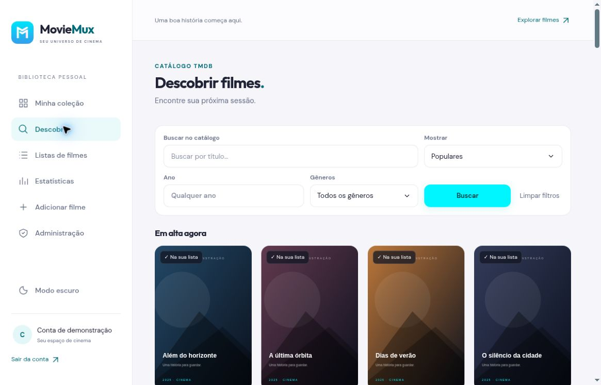
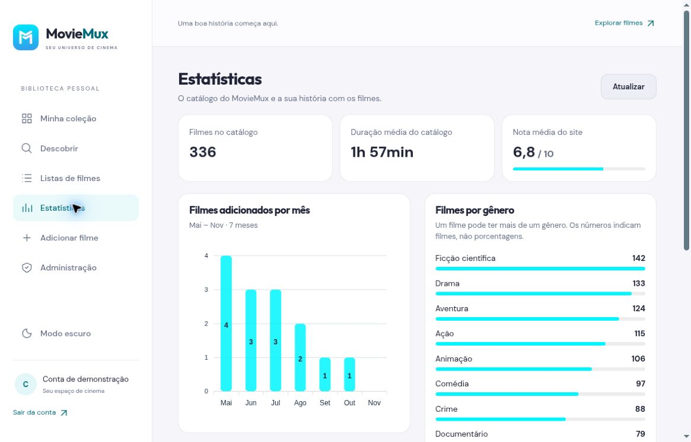
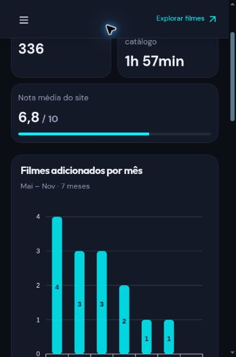

# MovieMux

A personal movie rating portal for discovering films, sharing ratings and organizing what to watch next. Inspired by IMDb and TMDB, MovieMux combines a community collection with personal watchlists and viewing statistics.

This branch contains the **Nuxt 4 migration**. Screenshots below show this implementation, not a claim that it has been deployed to the live website.

[Website · invitation required](https://www.moviemux.com) · [Getting started](#frontend-development-nuxt) · [Environment guide](docs/environment.md) · [Backend ecosystem](#project-ecosystem)

## Explore MovieMux

- **Discover and collect:** search the catalog, filter by genre and year, browse discovery categories, and sort the collection.
- **Rate together:** view film details, cast and providers, share ratings, and receive real-time updates through Socket.IO.
- **Browse without rating spoilers:** discovery ratings stay hidden until you explicitly reveal a film's rating. Group-voting visibility is handled separately.
- **Plan your next watch:** create public or private watchlists, search within a list and reorder its films.
- **See your viewing history:** explore catalog statistics and compare your own ratings and film durations with the community.
- **Manage your account:** invitation-based signup, profile settings, password recovery and role-based administration.

## Responsive by design

The custom interface adapts from desktop to narrow mobile layouts. Wide screens use a persistent sidebar and multi-column poster grids; narrow screens use drawer navigation, compact film details and reflowing filters, cards and statistics. Light and dark themes preserve the original MovieMux logo and cyan **`#00f6ff`** identity.

Keyboard focus indicators, reduced-motion styles and loading, empty and retry states are part of the interface. PWA support includes an offline notice and an update prompt. Installation depends on browser support and installability criteria; it is not a native app-store package, and authenticated content is not available as an offline library.

## Interface preview

Native browser captures from a local preview with **fictional demo accounts, films and statistics**. These screenshots show Brazilian Portuguese; the interface also supports English. The narrow views demonstrate responsive desktop-browser viewports, not physical-device certification.

### Discover films · desktop, light theme



### Statistics · desktop, light theme



### Statistics · narrow layout, dark theme

<p>
  
</p>

## Frontend architecture

- **Nuxt 4 + Vue 3 + TypeScript:** server rendering with the Node Nitro runtime, typed domain models and thin page adapters.
- **Pinia + TanStack Vue Query:** domain state and server-data querying; Axios is used for HTTP requests.
- **Custom Vue components + Sass:** shared UI primitives and responsive styling, with ApexCharts for charts and Swapy for list reordering.
- **Nuxt Auth Utils + a server-side BFF:** HttpOnly sessions, same-origin API calls and a Socket.IO bridge. Cloudflare Turnstile protects account operations.
- **Vite PWA:** public-asset caching, an explicit offline notice and in-app update handling.

The domain structure is retained rather than flattened into Nuxt pages:

- `src/modules/`: collection, discovery, movie details, watchlists, statistics, profile, authentication and administration, including their final route views.
- `src/pages/`: thin Nuxt route adapters that render the module views.
- `src/core/components/`, `src/core/ui/` and `src/css/`: shared interface components and styles.
- `src/server/`: the BFF, session/security controls and real-time bridge.
- `tests/` and `scripts/qa/`: automated checks and isolated local fixtures.

## Frontend development (Nuxt)

The frontend uses **Nuxt 4**, **Vue 3**, **TypeScript**, **Pinia** and a custom responsive design system. Domain modules remain in `src/modules`; `src/pages` only adapts existing module views to Nuxt routes. The original MovieMux logo and `#00f6ff` primary color are preserved in both themes.

### Requirements

- Node **26.13.0** (`.node-version` / `.nvmrc`)
- pnpm **12.16.1** (`packageManager`)

TypeScript **6.0.3** is the newest compatible compiler for the current Vue type checker and typescript-eslint. TypeScript 7.0.2 was tested but is not supported by those tools: vue-tsc cannot resolve its compiler API and typescript-eslint explicitly rejects it. Checks are retained rather than disabled.

### Run

```sh
npm install --global pnpm@12.16.1
pnpm install --frozen-lockfile
cp .env.example .env.local
pnpm dev --dotenv .env.local
```

Complete deployment variable reference and safe production template: [environment guide](docs/environment.md) · [`.env.production.example`](.env.production.example).

Configure the private server values below. Keep secrets out of `NUXT_PUBLIC_*` variables:

- `NUXT_API_UPSTREAM`: fixed gateway base including `/api`, e.g. `http://127.0.0.1:8080/api`.
- `NUXT_SOCKET_UPSTREAM`: fixed Socket.IO service origin, e.g. `http://127.0.0.1:3334`.
- `NUXT_TRUSTED_ORIGINS`: exact browser origins separated by commas, e.g. `https://moviemux.example`; no wildcards, paths or inferred forwarded Host.
- `NUXT_APP_SECRET`: generate with `openssl rand -base64 32`, store outside Git and retain across server restarts. Production startup rejects an absent/short secret.

The optional public `NUXT_PUBLIC_TMDB_IMAGE_BASE` is a nonsecret image CDN base, normally `https://image.tmdb.org/t/p`.

### Server-owned session and same-origin API

The browser calls only Nuxt `/api` and `/ws`. Nuxt Auth Utils 0.6.0 seals an HttpOnly session; upstream JWTs exist only in its private server data. Public session JSON/SSR contains whitelisted identity/roles, absolute expiry, a nonsecret generation and CSRF nonce—not bearer credentials. Existing `auth-kb` cookies are ignored and cleared on login/logout. Existing users must log in again after migration.

Unsafe requests require an explicitly trusted Origin; authenticated writes also require the session CSRF nonce. The BFF permits only known API paths/methods, forwards the JWT server-side, limits request/response sizes and rejects upstream redirects. Server rendering uses internal request-scoped dispatch, not a Host-derived network URL. Backend authorization remains authoritative. The backend has no implemented refresh-token route; expiry requires reauthentication rather than pretending to renew it.

A server-side Socket.IO protocol bridge preserves existing namespaces/events/rooms while supplying the JWT only to the upstream connection. Browser connections authenticate with the HttpOnly cookie and CSRF nonce. Expiry/logout ends associated bridges. The bridge targets the Node Nitro runtime and uses the official pinned Engine.IO/Nitro adapter; other deployment presets need separate validation.

**Deployment boundary:** the revocation registry is in-process. Logout rejects copied-cookie replay while that process remains alive, but clearing a sealed cookie cannot revoke every stolen copy after a restart. Multiple instances need shared revocation/session infrastructure and polling affinity; this is not silently provided. HTTPS and production Secure cookies are required. A local HTTP production smoke test may explicitly set `NUXT_SESSION_COOKIE_SECURE=false` only with exclusively loopback trusted origins; startup rejects that override for non-loopback origins.

### Turnstile account protection

The existing widget `0x4AAAAAAFwyH9xyrHzMmwps` protects login (including reauthentication), invitation signup, password-recovery requests and final password reset. No replacement widget is created. Each form uses an independent challenge lifecycle and obtains a fresh token after an attempted submission. The Nuxt BFF is the **only** Siteverify verifier: it checks strict success, the action and the exact configured hostname, then removes the challenge field before calling the unchanged Java endpoint. CSRF/Origin checks remain necessary and are not replaced by Turnstile.

Configure these runtime values before enabling the migration in production:

- `NUXT_PUBLIC_TURNSTILE_SITE_KEY`: the existing public sitekey above.
- `NUXT_PUBLIC_TURNSTILE_ENABLED`: defaults to `true`. Missing verifier configuration fails closed; it never silently removes protection.
- `NUXT_TURNSTILE_SECRET`: the existing widget's secret, supplied **only** through the server platform's secret manager. Never place it in a public variable, source control, browser storage or chat.
- `NUXT_TURNSTILE_HOSTNAMES`: comma-separated exact frontend hostnames (no scheme, port, wildcard or path). The historical site link is `www.moviemux.com`; confirm the actual widget/deployment hostnames rather than assuming its dashboard configuration. Do not include local hostnames in production.

Siteverify tokens are single-use and expire after five minutes. Missing/rejected/expired challenges or a verification outage cannot reach the protected upstream operation. Retry obtains a fresh challenge. The server uses Cloudflare's fixed HTTPS endpoint, bounded timeouts and sanitized errors; tokens and secrets are not logged. Cloudflare script/network availability is required for these protected forms. If deployment adds a CSP, allow the official `https://challenges.cloudflare.com` script/frame according to [Cloudflare's CSP guidance](https://developers.cloudflare.com/turnstile/reference/content-security-policy/).

**Ingress boundary:** only Nuxt should be public after migrating. Keep the gateway, monolith and event REST/Socket.IO services private and reachable by their intended internal callers. Otherwise callers can bypass a BFF-only challenge by reaching legacy account endpoints directly. No infrastructure changes are made by this integration. Do not hide those endpoints while the old frontend still depends on them, and do not verify the same token twice in Nuxt and Java.

For isolated loopback fixtures only, explicitly set `NUXT_PUBLIC_TURNSTILE_ENABLED=false`; startup rejects disabling with non-loopback trusted origins. This is configuration-based, never inferred from request Host. To exercise challenges locally use Cloudflare's separate official test keys and exact local hostnames (test keys are rejected for non-loopback deployments); do not add localhost to the production widget. Mock/unit and controlled verifier tests do not establish live acceptance of the existing production widget: final acceptance requires its privately configured secret/hostnames and a fresh browser token, then a rejected replay.

### Local same-origin backend testing

```sh
NUXT_API_UPSTREAM=http://127.0.0.1:18081/api \
NUXT_SOCKET_UPSTREAM=http://127.0.0.1:3334 \
NUXT_TRUSTED_ORIGINS=http://127.0.0.1:3000,http://localhost:3000 \
NUXT_PUBLIC_TURNSTILE_ENABLED=false \
NUXT_APP_SECRET="$(openssl rand -base64 32)" pnpm dev --host 127.0.0.1
```

The server-owned BFF replaces the earlier development-only forwarding proxy. Legacy public API/socket variables and `MOVIEMUX_DEV_API_ORIGIN` are not the session transport configuration. No gateway CORS changes are needed: browser traffic is same-origin, including PATCH. Configure the gateway to reach the local monolith and the separate socket service normally.

### Verify and build

```sh
pnpm lint
pnpm typecheck
pnpm test
pnpm build
pnpm test:ssr
pnpm test:session
pnpm test:turnstile
pnpm test:health
pnpm test:socket
pnpm test:pwa
node .output/server/index.mjs
```

`test:ssr` runs the production build against isolated fictional fixtures and checks HttpOnly login, safe public claims, concurrent session isolation, role denial, CSRF rejection, logout replay rejection, routes and PWA assets. `test:session` runs independent HTTP/SSR/Socket.IO policy and cookie-configuration regressions against the built server using ephemeral synthetic upstreams. `test:socket` additionally checks full polling/WebSocket namespace connections, transport/session binding, room isolation, reconnect and cleanup through the actual built BFF. `test:turnstile` runs the actual built BFF against a process-local interception of only the fixed Siteverify endpoint and disposable account fixtures; it proves gate/payload/configuration behavior without a real Cloudflare secret or external network. The interception exists only in the explicitly loaded test fixture, never application runtime configuration. Component/unit tests use mocks. Neither replaces acceptance against the real backend.

For a local interactive preview without a backend, see [QA fixture instructions](scripts/qa/README.md). Fixture tokens are not real credentials and that server must never be deployed.

### Deployment

The Dockerfile builds a Nitro server and runs as non-root. Supply endpoint variables at runtime; expose port 3000. The runtime entrypoint changed from Quasar's `dist/ssr/index.js` to **`.output/server/index.mjs`**. No backend contracts or database changes are needed.

The image includes a Node-only Docker HEALTHCHECK against unauthenticated `GET /healthz` (30-second interval, 5-second timeout, 30-second start period, 3 retries). It checks frontend process liveness only, not API/Turnstile readiness; see the [healthcheck configuration](docs/environment.md#healthcheck-da-imagem). `pnpm test:health` exercises the probe and built route with disposable local fixtures.

PWA support preserves the app's original icons and standalone presentation. Only public frontend assets and the explicit offline notice are precached; authenticated API data is not cached. Updates are offered through an in-app prompt.

## Project ecosystem

The frontend works with these separate services. Existing repository links are retained:

- [MovieMux Back-End](https://github.com/HenriqueMendesCoelho/cine-kronusBoss-api): the main application API. This historical URL redirects to the current `moviemux-api` repository.
- [MovieMux Socket.IO Back-End](https://github.com/HenriqueMendesCoelho/moviemux-websocket): real-time events and updates.
- [MovieMux Gateway](https://github.com/HenriqueMendesCoelho/moviemux-gateway): routing to the backend services behind the Nuxt BFF.

Related integration projects:

- [Kronus Integration Tool Front-End](https://github.com/HenriqueMendesCoelho/kronus-integration-tool-frontend)
- [Kronus Integration Tool Back-End](https://github.com/HenriqueMendesCoelho/kronus-integration-tool-api)

## Attribution

This product uses the TMDB API but is not endorsed or certified by TMDB.

### Interface languages

MovieMux supports **Brazilian Portuguese (default)** and **English** through Nuxt i18n and Vue I18n. Use the language selector on public screens or in desktop/mobile navigation. The choice is stored for one year in the same-site `moviemux-language` preference cookie and survives navigation, reloads and sign-out. New visitors see Portuguese regardless of browser language. URLs, existing query parameters and backend payloads are unchanged.

Translation resources live in `i18n/locales/{pt-BR,en}/`, grouped into shell, shared components, account, catalog, library/statistics and page metadata. Add semantic keys to both catalogs, keep interpolation parameters identical, and use full sentences/plural forms rather than concatenated fragments. Use computed labels or message getters when text must update while an existing dialog, notification or view stays open. Pure formatting helpers receive an explicit locale. `pnpm test` checks resource parity, message compilation and reactive UI flows; `pnpm test:i18n:ssr` checks real production SSR with fictional loopback data after `pnpm build`.

Movie titles, synopses, user names, comments and watchlist content remain as received. Known genre labels are translated for display, while IDs and remote metadata requests stay unchanged. Browser/OS-owned installation wording is controlled by the browser; MovieMux's own install/update notices and offline page support both languages. A completed security challenge is preserved when the interface language changes; the next challenge uses the new language.
